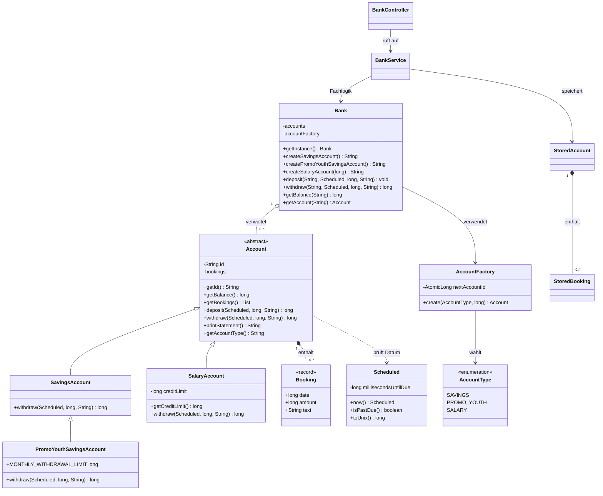

# Klassendiagramm – Bank

## Ausgangslage und Bezug zum Code

Die ursprüngliche Situation beschreibt eine Kundin oder einen Kunden am Bankschalter. Das Java-Projekt implementiert bisher **keine eigenen Klassen für Kunden oder Bankmitarbeiter**, sondern die fachliche Verarbeitung der Konten. Das folgende Diagramm zeigt daher die tatsächlich vorhandenen Java-Klassen und ihre Beziehungen.

## Klassendiagramm der Implementierung

## Erklärung der Beziehungen

- **Vererbung:** `Account` ist abstrakt. `SavingsAccount` verbietet Überzüge; `SalaryAccount` besitzt eine Kreditlimite; `PromoYouthSavingsAccount` erbt vom Sparkonto und begrenzt monatliche Auszahlungen.
- **Komposition:** Die Buchungsliste gehört zum Konto. Der Saldo wird aus den Beträgen der Buchungen berechnet.
- **Factory:** Die `AccountFactory` erzeugt passende Konten und vergibt eindeutige Nummern.
- **Singleton:** `Bank.getInstance()` liefert die gemeinsame Instanz pro JVM.
- **REST und Speicherung:** `BankController` nimmt HTTP-Anfragen entgegen, `BankService` verarbeitet sie, und die Persistenzklassen speichern Konten samt Buchungen.

## Verbindung zu den Anwendungsfällen

| Anwendungsfall | Zuständige Klassen und Methoden |
|---|---|
| UC-01: Konto eröffnen | `Bank.createSavingsAccount()`, `createSalaryAccount()`, `AccountFactory` |
| UC-02: Einzahlung tätigen | `Bank.deposit()`, `Account.deposit()`, `Booking` |
| UC-03: Auszahlung tätigen | `Bank.withdraw()`, `Account.withdraw()`, Kontounterklassen |
| UC-04: Kontoauszug erhalten | `Account.getBookings()`, `Account.printStatement()` |

Die visuelle Modellierung des fachlichen Bankschalters ist im [Anwendungsfalldiagramm](use-case-diagram.md) dokumentiert.

**Abgrenzung:** Kundendaten, Bankmitarbeiterverwaltung und ein physischer Ausdruck sind Anforderungen auf Szenarioebene, aber aktuell nicht implementiert. Die Beträge werden als `long` in Millirappen gespeichert, nicht als `double`.
