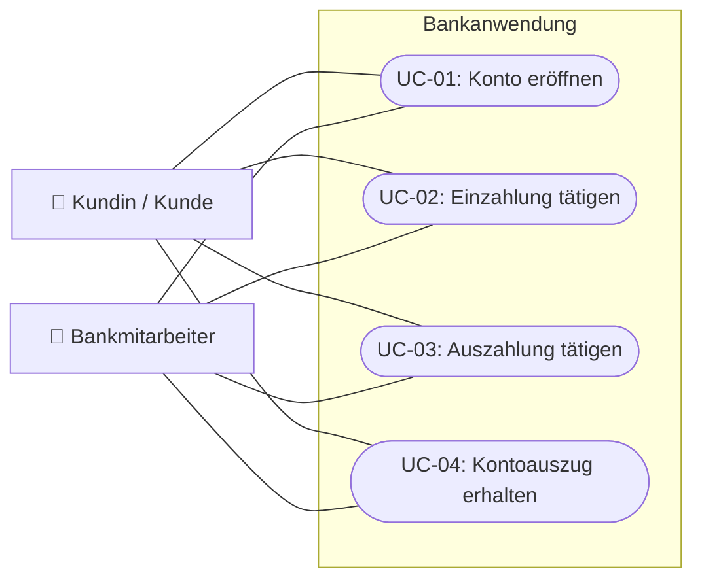

# Anwendungsfalldiagramm – Bank am Schalter

Die Aufgabenstellung beschreibt **vier Anwendungsfälle** und zwei fachliche Akteure. Die Kundin beziehungsweise der Kunde veranlasst den Vorgang; die Bankmitarbeiterin beziehungsweise der Bankmitarbeiter führt ihn am Schalter aus.

## Anwendungsfälle und Beschreibungen

1. [UC-01 – Konto eröffnen](use-cases/UC-01-Konto-eroeffnen.md)
2. [UC-02 – Einzahlung tätigen](use-cases/UC-02-Einzahlung.md)
3. [UC-03 – Auszahlung tätigen](use-cases/UC-03-Auszahlung.md)
4. [UC-04 – Kontoauszug erhalten](use-cases/UC-04-Kontoauszug.md)

Die Grafik ist eine auf GitHub direkt sichtbare Darstellung. Für eine formale UML-Use-Case-Notation mit Akteursymbolen und ovalen Anwendungsfällen liegt die [PlantUML-Quelldatei](use-case-diagram.puml) daneben.

**Abgrenzung:** Der aktuelle Java-Code verwaltet Konten und Buchungen; eigene Benutzeroberflächen für Bankmitarbeiter oder Kundenstammdaten sind nicht vorhanden.
